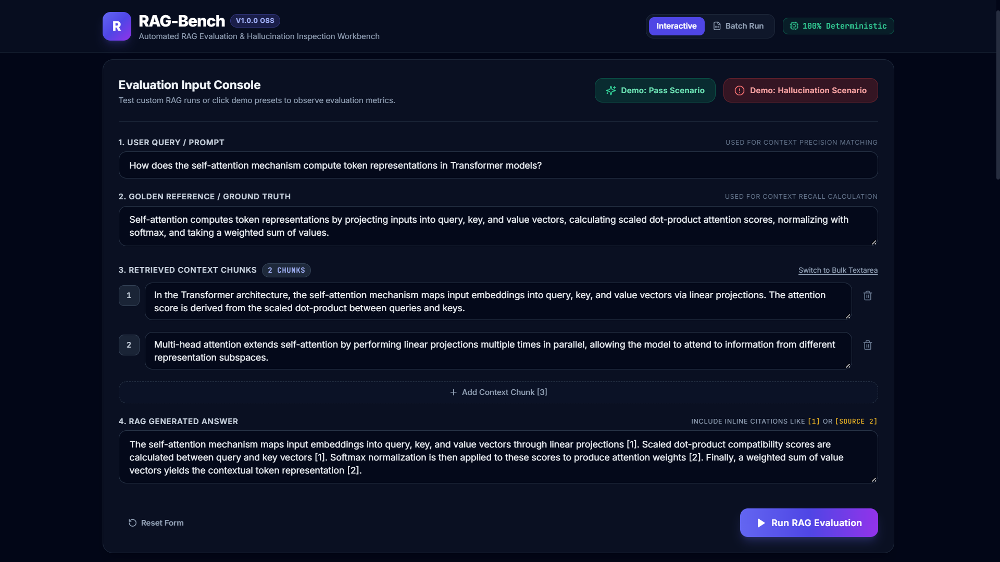
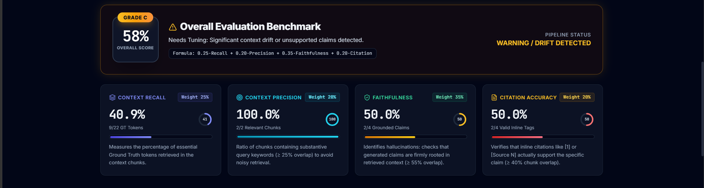
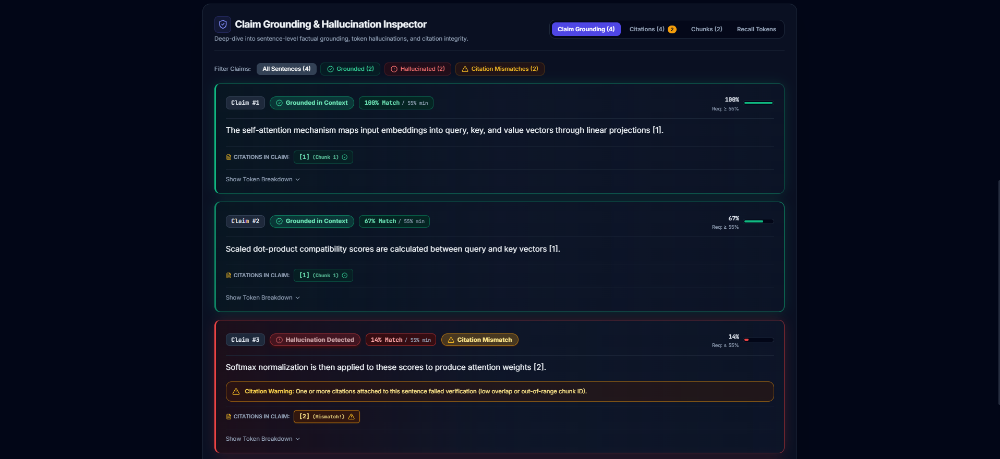
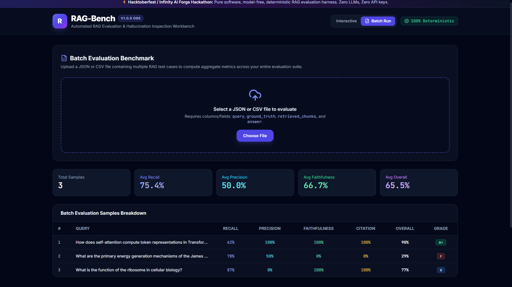

# ⚡ RAG-Bench: Automated RAG Evaluation & Hallucination Inspection Workbench

> **A pure software, model-free, deterministic RAG evaluation harness + interactive dashboard measuring Context Recall, Context Precision, Faithfulness, and Citation Accuracy.**
> Built for Hacktoberfest & Infinity AI Forge Hackathon. Zero LLMs, Zero Embeddings, Zero API Keys, Zero Rate Limits. 100% Deterministic & Reproducible.

---

## 🌐 Live Demo
- **Frontend**: https://rag-evaluation-workbench-eight.vercel.app/
- **Backend**: https://rag-evaluation-workbench.onrender.com
- **API Docs**: https://rag-evaluation-workbench.onrender.com/docs

---

## 📸 Screenshots





---

## 🌟 Overview

Evaluating Retrieval-Augmented Generation (RAG) pipelines traditionally relies on costly, non-deterministic LLM-as-a-judge approaches (e.g. GPT-4). These suffer from high latency, API rate limits, non-reproducible grading, and substantial ongoing costs.

**RAG-Bench** provides a **model-free, purely algorithmic evaluation harness** and interactive inspection workbench. Using token overlap, Jaccard similarity heuristics, citation graph analysis, and boundary-aware sentence segmentation, RAG-Bench deterministically evaluates RAG queries and provides sentence-level claim grounding with visual hallucination detection in milliseconds.

---

## 🏗️ Architecture Diagram

```
+---------------------------------------------------------------------------------------+
|                                    RAG-Bench UI                                       |
|  (React 18 + Vite + Tailwind CSS + Lucide Icons + Interactive Claim Inspector)        |
+-------------------------------------------+-------------------------------------------+
                                            |
                                  HTTP REST / JSON
                                            |
                                            v
+---------------------------------------------------------------------------------------+
|                                FastAPI Backend Server                                 |
|     (/api/evaluate, /api/preset/pass, /api/preset/hallucination, /api/upload)         |
+-------------------------------------------+-------------------------------------------+
                                            |
                                            v
+---------------------------------------------------------------------------------------+
|                       Deterministic Evaluation Engine (eval_engine.py)                |
|                                                                                       |
|   1. Tokenizer & Stopword Normalizer (case-folding, punctuation strip, token filter)  |
|   2. Context Recall Engine:           |GT ∩ Retrieved Chunks| / |GT|                  |
|   3. Context Precision Engine:        |Relevant Chunks (overlap ≥ 25%)| / |Total|     |
|   4. Sentence Splitter & Grounding:   Claim overlap with all context (threshold ≥ 55%)|
|   5. Citation Verification Engine:    Target chunk overlap verification (≥ 40%)       |
|   6. Weighted Scorer & Grader:        0.25*Rec + 0.20*Prec + 0.35*Faith + 0.20*CitAcc |
+---------------------------------------------------------------------------------------+
```

---

## 📐 How the Four Core Metrics Work

### 1. Context Recall
- **Goal**: Measures how much of the golden reference answer (Ground Truth) was successfully retrieved in the context passages.
- **Formula**:
  $$\text{Recall} = \frac{|\text{GT Tokens} \cap \text{All Retrieved Tokens}|}{|\text{GT Tokens}|}$$
- **Edge cases**: Empty Ground Truth returns `1.0` (trivially recalled); empty retrieved chunks return `0.0`.

### 2. Context Precision
- **Goal**: Measures whether retrieved chunks are relevant to the user query rather than unhelpful noise.
- **Relevance Rule**: A chunk is classified as **Relevant** if:
  $$\frac{|\text{Query Tokens} \cap \text{Chunk Tokens}|}{|\text{Query Tokens}|} \ge 0.25$$
- **Formula**:
  $$\text{Precision} = \frac{\text{Number of Relevant Chunks}}{\text{Total Retrieved Chunks}}$$

### 3. Faithfulness (Hallucination Detection)
- **Goal**: Identifies ungrounded factual claims and outright hallucinations in the generated answer.
- **Sentence Splitter**: Robust segmentation parsing punctuation boundaries (`.`, `!`, `?`) while protecting abbreviations and decimals.
- **Grounding Rule**: A claim sentence is **Supported** if its token overlap with the combined retrieved context is $\ge 0.55$:
  $$\text{Sentence Overlap} = \frac{|\text{Sentence Tokens} \cap \text{All Retrieved Tokens}|}{|\text{Sentence Tokens}|} \ge 0.55$$
- **Formula**:
  $$\text{Faithfulness} = \frac{\text{Number of Supported Sentences}}{\text{Total Sentences}}$$
- **Visual Highlight**: Flagged as **Green** (Grounded) or **Red** (Hallucination Detected) with token-level missing evidence breakdown.

### 4. Citation Accuracy
- **Goal**: Verifies that inline citation tags (e.g. `[1]`, `[2]`, `[Source 3]`) genuinely support the claim they accompany.
- **Verification Rule**:
  1. The cited chunk index $N$ must exist within retrieved chunks ($1 \le N \le \text{Total Chunks}$).
  2. The claim sentence must have $\ge 0.40$ token overlap with that specific cited chunk.
- **Formula**:
  $$\text{Citation Accuracy} = \frac{\text{Valid Citations}}{\text{Total Extracted Citations}}$$
- *Fallback*: If no inline citations exist, assigns `1.0` if Faithfulness $\ge 0.70$, otherwise `0.0`.

### Overall Score & Grade
$$\text{Overall Score} = 0.25 \times \text{Recall} + 0.20 \times \text{Precision} + 0.35 \times \text{Faithfulness} + 0.20 \times \text{Citation Accuracy}$$

| Overall Score | Grade | Status & Verdict |
|:---|:---:|:---|
| $\ge 90\%$ | **A+** | Production Ready: Outstanding context grounding and citation fidelity. |
| $\ge 80\%$ | **A** | High Quality: Reliable context recall with minor precision noise. |
| $\ge 70\%$ | **B** | Acceptable: Minor grounding gaps or ungrounded phrasing. |
| $\ge 50\%$ | **C** | Needs Tuning: Significant context drift or unsupported claims detected. |
| $< 50\%$ | **F** | Critical Failure: Severe hallucinations or retrieval mismatch detected. |

---

## 📁 Directory Structure

```
rag-evaluation-workbench/
├── backend/
│   ├── app.py              # FastAPI server & endpoints
│   ├── eval_engine.py      # Core deterministic evaluation logic
│   └── requirements.txt    # Python dependencies
├── frontend/
│   ├── src/
│   │   ├── components/
│   │   │   ├── InputForm.jsx     # Input console & demo preset triggers
│   │   │   ├── MetricCards.jsx   # 4 metric cards + Overall Score hero
│   │   │   └── Inspector.jsx     # Visual Claim Grounding & Hallucination Inspector
│   │   ├── App.jsx               # Main workbench layout & batch runner
│   │   ├── index.css             # Tailwind CSS & custom design system
│   │   └── main.jsx              # Application bootstrap
│   ├── .env.example              # Environment variables template (VITE_API_URL)
│   ├── package.json
│   ├── vite.config.js
│   ├── tailwind.config.js
│   └── index.html
├── docs/
│   └── screenshots/              # UI demo screenshots & previews
├── samples/
│   ├── batch_sample.json   # Ready-to-use sample batch JSON dataset
│   └── batch_sample.csv    # Ready-to-use sample batch CSV dataset
└── README.md
```

---

## 🚀 Quickstart & Setup Instructions

### Prerequisites
- Python 3.10+
- Node.js 18+ and npm

### 1. Backend Setup

```bash
# Navigate to the backend directory
cd backend

# Create and activate a virtual environment
python -m venv .venv

# On Windows:
.venv\Scripts\activate
# On Linux / macOS:
source .venv/bin/activate

# Install dependencies
pip install -r requirements.txt

# Start the FastAPI server
python -m uvicorn app:app --host 127.0.0.1 --port 8000 --reload
```
The backend API will be available at: `http://127.0.0.1:8000`  
Interactive Swagger docs: `http://127.0.0.1:8000/docs`

### 2. Frontend Setup

```bash
# In a new terminal, navigate to the frontend directory
cd frontend

# Install dependencies
npm install

# Start Vite dev server
npm run dev
```
Open your browser at `http://127.0.0.1:5173`.

---

## 🕹️ Demo Instructions

1. **Test "Pass Scenario"**:
   - Click the green **"Demo: Pass Scenario"** button.
   - Observe **Grade A / A+ (90%+)** with all claims grounded in green cards, matching Transformer self-attention queries.
2. **Test "Hallucination Scenario"**:
   - Click the red **"Demo: Hallucination Scenario"** button.
   - Observe **Grade F (36%)** failure:
     - **Red Cards**: Sentences claiming "cold fusion reactors" or "tachyon transceivers" are flagged immediately with missing context tokens.
     - **Yellow Tags**: Citation mismatches highlighted (e.g. citing `[Source 5]` when only 3 chunks exist).
     - **Token Breakdown**: Click *Show Token Breakdown* to view exact hallucinated words.
3. **Run Batch Evaluation**:
   - Switch to **"Batch Run"** in the top navigation.
   - Upload `samples/batch_sample.json` or `samples/batch_sample.csv`.
   - View instant aggregate recall, precision, faithfulness, and citation metrics across the whole suite.

---

## 🔌 API Documentation

### `POST /api/evaluate`
Accepts a single RAG inference query, ground truth, retrieved chunks, and answer.
```json
{
  "query": "How does self-attention work in Transformers?",
  "ground_truth": "Self-attention maps input queries, keys, and values into representations.",
  "retrieved_chunks": [
    "In the Transformer architecture, self-attention computes query, key, and value projections."
  ],
  "answer": "Self-attention computes query, key, and value vectors [1]."
}
```

### `GET /api/preset/pass`
Returns the verified high-fidelity demo case with pre-calculated metrics.

### `GET /api/preset/hallucination`
Returns the demo case exhibiting severe hallucinations and invalid citations.

### `POST /api/upload`
Accepts multipart file upload (`.json` or `.csv`) and returns aggregate batch metrics plus sample-by-sample diagnostics.

### `GET /api/health`
Returns system status and version info.

---

## 🛠️ Tech Stack

- **Backend**: Python 3.12, FastAPI, Uvicorn, Pydantic v2
- **Frontend**: React 18, Vite, Tailwind CSS, Lucide React Icons
- **Design**: Dark/Light mode theme, responsive layout, glassmorphic cards, glowing diagnostic badges
- **NLP Heuristics**: Token overlap, stopword filtration, abbreviation-aware sentence boundary detection, regex citation parser

---

## 📜 License

MIT License. Free to use, modify, and distribute for Hacktoberfest and beyond.
